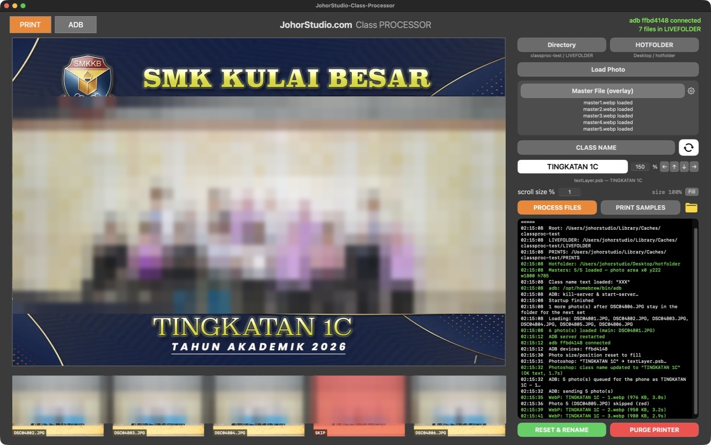
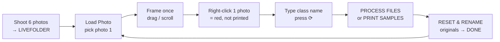
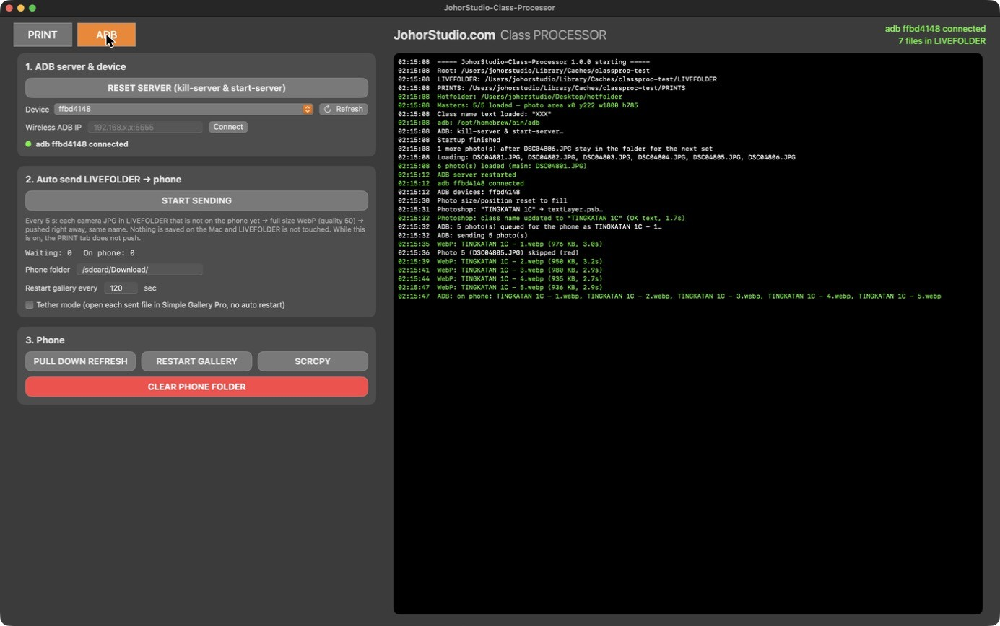

<div align="center">

# JohorStudio Class Processor

**Class photos from camera to print and phone, in a few clicks.**

Load a group of shots, frame them once, type the class name, and every photo comes out on its own
master overlay at 4R, ready for the printer, with a copy on the customer's phone.


<br>



<sub>PRINT tab: photo 1 on master 1 with the class name from Photoshop. Photo 5 is marked red (not printed). Student photos are blurred in this screenshot.</sub>

</div>

---

## Contents

- [What it does](#what-it-does)
- [Requirements](#requirements)
- [Artwork templates](#artwork-templates)
- [Download (no build needed)](#download-no-build-needed)
- [Install (build from source)](#install-build-from-source)
- [Event folder](#event-folder)
- [First-time setup](#first-time-setup)
- [Workflow](#workflow)
- [Rules](#rules)
- [Not enough photos, or too many](#not-enough-photos-or-too-many)
- [PRINT tab: buttons](#print-tab-buttons)
- [ADB tab: buttons](#adb-tab-buttons)
- [CAMERA tab: Sony A7R II over USB](#camera-tab-sony-a7r-ii-over-usb)
- [Output files](#output-files)
- [Troubleshooting](#troubleshooting)
- [Project layout](#project-layout)

---

## What it does

| | |
|---|---|
| **Groups of 6** | Pick photo 1 and the next 5 photos (by file name) load with it. One of the six is marked red and is never printed. |
| **Fast preview** | 42 MP files are previewed from ~2000 px snapshots. Only PROCESS reads the full original. |
| **Frame once** | Drag and scroll the big preview. The size and position are saved and used for every photo, set after set. |
| **5 masters** | `xxxx1.webp` … `xxxx5.webp` (1800×1200, transparent photo window). Each photo that is not red gets the next master. |
| **Real Photoshop text** | The class name goes into the text layer of `textLayer.psb`. Photoshop renders it, so gradients and effects stay exactly as designed. |
| **Print** | JPG 1800×1200 (4R), Q95, 300 DPI, sRGB, saved in `PRINTS/`, and copied to the printer hotfolder on demand. Existing files are never overwritten. |
| **Phone** | Full-size WebP pushed to an Android phone over ADB, either with the class name (PRINT tab) or with the camera name (auto-send). |
| **Safe with originals** | Camera files are only read. They are renamed `CLASS - 1…5` / `CLASS - xx` and moved to `LIVEFOLDER/DONE` only when you press **RESET & RENAME**. |
| **Camera tether** | A Sony A7R II on a USB cable: every shot downloads straight into `LIVEFOLDER` with gphoto2. No other tether software. |
| **Logged** | Every export, copy, rename and push appears in the log box and in `log/YYYY-MM-DD.log`. |

---

## Requirements

| What | Why | How to get it |
|---|---|---|
| **Mac with Apple Silicon** (M1 or later), **macOS 14+** | The app is built for arm64. It was tested on macOS 27. | — |
| **Xcode Command Line Tools** (Swift 5.9+) | Compiles the app. Full Xcode is **not** needed. | `xcode-select --install` |
| **Internet on the first build** | Swift Package Manager downloads [libwebp](https://github.com/SDWebImage/libwebp-Xcode) (WebP encoder, linked into the app). | — |
| **Adobe Photoshop 2026** | Renders the class name from `textLayer.psb`. | Creative Cloud |
| **Android platform tools (`adb`)** | Sends photos to the phone. Expected at `/opt/homebrew/bin/adb`. | `brew install android-platform-tools` |
| **Homebrew** | Installs `adb`, `scrcpy` and the GitHub CLI. | [brew.sh](https://brew.sh) |
| **GitHub account with access** + **GitHub CLI** (`gh`) | The repository is private. `gh auth login` lets `git` clone and pull. | `brew install gh` |
| *Optional:* **scrcpy** | Shows the phone screen on the Mac (SCRCPY button). | `brew install scrcpy` |
| *Optional:* **gphoto2** | Camera tether in the CAMERA tab (Sony A7R II over USB). Expected at `/opt/homebrew/bin/gphoto2`. | `brew install gphoto2` |
| **Android phone** with **USB debugging** on, and **Simple Gallery Pro** | Shows the photos to the customer. | Developer options › USB debugging |
| **Printer** set as the macOS **default printer**, plus its **hotfolder** software | PRINT SAMPLES copies JPGs into the hotfolder. PURGE PRINTER clears the default printer's queue. | Printer driver / hotfolder app |
| **Artwork**: `xxxx1.webp` … `xxxx5.webp` and `textLayer.psb` | Masters (1800×1200, photo window transparent) and the class name text layer. | [`templates/`](templates) in this repo |

---

## Artwork templates

The `templates/` folder holds the Photoshop and overlay files used with the app. Copy them into the event folder, or open them in Photoshop to make a new design.

| File | What it is |
|---|---|
| `master1.webp` … `master5.webp` | The 5 overlays, 1800×1200. The photo window must be **transparent**. Choose `master1.webp` with **Master File (overlay)**. |
| `textLayer.psb` | Class name text layer (2429×100). The app changes **only the text** of its first text layer, so the font, gradient and effects stay as designed. Choose it with **CLASS NAME**. |
| `masterSort.psd` | Layout reference: where `textLayer` sits on the 1800×1200 master. This gives the default text area X/Y/W/H = 0/1024/1800/74. |
| `layoutUI.psd` / `layoutUI.webp` | The original UI mock-up of the PRINT tab. |

**Making a new design:** keep the canvas at 1800×1200, export 5 WebP files with the same name ending in `1` … `5`, and leave the photo window transparent. For the class name, edit the text style in `textLayer.psb` and keep a single text layer. If the text sits in a different place, adjust it with ⚙︎, the % box or the arrow buttons.

---

## Download (no build needed)

Get the ready-made app and the templates from **[Releases](https://github.com/RafieRosliputra/johorstudio-class-processor/releases/latest)**:

| File | What |
|---|---|
| `JohorStudio-Class-Processor-v1.0.0-macOS-arm64.zip` | The app (Apple Silicon) |
| `JohorStudio-Class-Processor-templates-v1.0.0.zip` | `master1–5.webp`, `textLayer.psb`, `masterSort.psd`, `layoutUI` |

1. Unzip both and put `JohorStudio-Class-Processor.app` in the event folder.
2. The app is not notarized by Apple. Clear the download flag once:
   `xattr -dr com.apple.quarantine "JohorStudio-Class-Processor.app"` (or right-click › **Open** › **Open**).
3. Open it and follow [First-time setup](#first-time-setup).

You still need **Photoshop 2026** and `adb` (`brew install android-platform-tools`), plus `gphoto2` for the camera tether (`brew install gphoto2`), but **not** the Xcode Command Line Tools.

---

## Install (build from source)

```bash
# 1. Apple build tools (once)
xcode-select --install

# 2. adb (and optionally scrcpy, and gphoto2 for the camera tether)
brew install android-platform-tools scrcpy gphoto2

# 3. Sign in to GitHub (the repository is private) and get the code
brew install gh
gh auth login            # GitHub.com › HTTPS › Login with a web browser
cd ~/Desktop
gh repo clone RafieRosliputra/johorstudio-class-processor
cd johorstudio-class-processor

# 4. Build
./scripts/build_app.sh
```

You can also double-click **`build.command`** in Finder.

- The first build takes 2 to 5 minutes, because it downloads and compiles libwebp.
- When it finishes, Finder opens the `build` folder with **`JohorStudio-Class-Processor.app`**.
- `warning:` lines are fine. Only `error:` matters.
- To build straight into an event folder: `./scripts/build_app.sh ~/Desktop/MyEvent`.

**Update later:**
```bash
cd ~/Desktop/johorstudio-class-processor && git pull && ./scripts/build_app.sh
```

> **macOS says the app is damaged or from an unknown developer?**
> `xattr -dr com.apple.quarantine "JohorStudio-Class-Processor.app"`, then open it again.

---

## Event folder

Put the app inside the event folder. That folder is the **root**, and everything is created next to the app:

```
2026 SMK Kulai Besar Class Photo/        ← root
├── JohorStudio-Class-Processor.app
├── settings.json        all settings: folders, masters, PSB, photo size/position, ADB…
├── LIVEFOLDER/          camera JPGs arrive here (the Directory button can change it)
│   ├── .gphoto2-incoming/  hidden: photos still downloading from the camera (CAMERA tab)
│   ├── RAW/             RAW files when the camera shoots RAW+JPEG (CAMERA tab)
│   ├── DONE/            camera originals after RESET & RENAME: "TINGKATAN 1C - 1.jpg" … "- xx.jpg"
│   └── WEBP/            class-named WebP pushed from the PRINT tab (auto-send off)
├── PRINTS/              finished 1800×1200 JPG: "TINGKATAN 1C - 1.jpg" …
├── log/                 2026-10-20.log
└── cache/               classname.png (text layer rendered by Photoshop)
```

---

## First-time setup

1. Open the app. It creates the folders and runs `adb kill-server` / `adb start-server`.
2. **Directory**: the camera folder. The default is `root/LIVEFOLDER`.
3. **HOTFOLDER**: the printer's hotfolder.
4. **Master File (overlay)**: choose `xxxx1.webp`. The app finds `xxxx2…5.webp` next to it and lists what it loaded. The photo window is detected from master 1's transparency.
5. **CLASS NAME**: choose `textLayer.psb`.
6. Press **⟳ (refresh)** once. macOS asks *"JohorStudio-Class-Processor wants to control Adobe Photoshop 2026"*. Click **Allow**.
7. Plug in the phone and allow USB debugging on it. The top-right corner shows **adb … connected** in green.
8. *Optional, camera on USB:* set the A7R II to **PC Remote**, plug it in, open the **CAMERA** tab and press **START TETHER**. The top-right corner shows **camera … connected** in green. See [CAMERA tab](#camera-tab-sony-a7r-ii-over-usb).

All of this is saved in `settings.json`, so you only do it once per event.

---

## Workflow



1. **Shoot the class.** Six photos land in `LIVEFOLDER`. The top-right counter shows how many are there.
2. **Load Photo.** Choose the oldest photo of the group (photo 1). It and the next 5 photos by file name are loaded. Photo 1 is the big preview, photos 2–6 are the small boxes.
3. **Frame.** Drag the big preview to move the photo, scroll to resize it. *scroll size %* sets the step for each notch, and **Fill** goes back to 100% and centred. The setting stays for the next sets.
4. **Mark the reject.** Right-click the small photo that will **not** be printed. It turns red. Six photos are loaded but there are only five masters, so **one photo is always left out**.
5. **Class name.** Type it in the white box (it becomes upper case) and press **⟳**. Photoshop updates the text layer.
   With auto-send **off**, the photos that are not red are pushed to the phone at once as `TINGKATAN 1C - 1.webp` … `- 5.webp`.
6. **PROCESS FILES** writes the JPGs to `PRINTS/`. **PRINT SAMPLES** does the same and also copies them to the hotfolder.
7. **RESET & RENAME** (green). The camera originals are renamed and moved to `LIVEFOLDER/DONE`, the slots are cleared, and the class name goes back to `XXX`. Then load the next group.

---

## Rules

- **A group is 6 photos.** Loading takes the chosen photo plus the next 5 by file name. Later files stay in the folder for the next group.
- **One photo is never printed.** With 6 photos, PROCESS refuses to run until one small photo is red. Photo 1 (the big preview) cannot be red.
- **Masters follow the photos that are not red, in order.** Example with photo 4 red: photos 1, 2, 3 → masters 1, 2, 3 and photos 5, 6 → masters 4, 5. Output and DONE numbers follow the master number (`- 1` … `- 5`). The red photo becomes `- xx`.
- **The class name must be set.** The app starts with `XXX` in the box and in the text layer, and PROCESS will not run with `XXX`. If the text in the box differs from the text layer, PROCESS presses ⟳ for you first.
- **Mark red before ⟳.** The WebP sent from the PRINT tab skips red photos and uses the final numbers. If you change the red photo afterwards, ⟳ sends again with the new numbers. Older files on the phone are not deleted.
- **Nothing is overwritten.** If `PRINTS/TINGKATAN 1C - 1.jpg` or the same file in the hotfolder already exists, it is skipped and logged. Name clashes in `DONE` get ` (2)`.
- **Camera files are only touched by RESET & RENAME.** Reset before ⟳ or PROCESS only clears the slots, and no file is renamed.
- **Output names come from the text layer** with no date: `TINGKATAN 1C - 1.jpg`.

---

## Not enough photos, or too many

| Situation | What to do |
|---|---|
| **Fewer than 6 left after the chosen photo** | They load anyway (1–5). Empty boxes stay empty and each photo is processed as usual: 3 photos give 3 prints on masters 1–3, and 1 photo gives 1 print. |
| **A class really has only 4 (or 5) photos, and other classes' photos follow** | Make a new folder inside `LIVEFOLDER`, move those 4 photos into it, and **Load Photo** from that folder. Prints, WebP and `DONE` still go to the usual places (`PRINTS/`, `LIVEFOLDER/WEBP`, `LIVEFOLDER/DONE`). The empty folder is left behind. |
| **You fell behind (e.g. 18 photos waiting)** | Choose the oldest photo of the next class as photo 1. Its group of 6 loads and the rest stay in the folder. Process, RESET & RENAME, then load the next group. |
| **6 photos and none red** | PROCESS shows *Mark one photo red*. Right-click the photo that should not be printed. |

---

## PRINT tab: buttons

| Control | Action |
|---|---|
| **PRINT / ADB** | Switch tabs. |
| **adb … connected** *(top right)* | Phone status: green when connected, red when not. Under it is the number of camera JPGs waiting in `LIVEFOLDER`. |
| **Directory** | Choose the camera folder (`LIVEFOLDER`). |
| **HOTFOLDER** | Choose the printer's hotfolder (used by PRINT SAMPLES). |
| **Load Photo** | Choose photo 1. It and the next 5 photos load. |
| **Master File (overlay)** | Choose `xxxx1.webp`. Masters 2–5 are found automatically and listed below the button. |
| **⚙︎** | X / Y / W / H of the class name text on the 1800×1200 master. Default 0 / 1024 / 1800 / 74. |
| **CLASS NAME** | Choose `textLayer.psb`. |
| **⟳** | Photoshop puts the class name into the text layer, saves the PSB and exports the PNG. The button turns **orange** when the box differs from the text layer. With auto-send off, it also pushes WebP to the phone. |
| **Class name box** | Type the class name (upper case). Enter does the same as ⟳. |
| **% box** | Size of the class name text (100% fits the text area). |
| **← ↑ ↓ →** | Move the class name text by 5 px. Option-click moves 1 px, Shift-click moves 20 px. |
| **Big preview** | **Drag** to move the photo, **scroll** to resize it, **click** (without dragging) for Quick Look. |
| **Small boxes** | **Click** for Quick Look. **Right-click** to toggle red (not printed). |
| **scroll size %** / **Fill** | Resize step per scroll notch / back to 100%, centred. |
| **PROCESS FILES** | Export the JPGs to `PRINTS/` (skips files that already exist). |
| **PRINT SAMPLES** | PROCESS, then copy each JPG to the hotfolder (skips files that are already there). |
| **📁** | Open `PRINTS/` in Finder. |
| **Log box** | Live log. The same lines go to `log/`. |
| **RESET PHOTO** | Clear the slots, show *no photo loaded*, set the class name to `XXX` (box and text layer). |
| **RESET & RENAME** *(green)* | Shown after ⟳ or PROCESS. Renames the camera files `CLASS - 1…5` / `CLASS - xx`, moves them to `LIVEFOLDER/DONE`, then resets. |
| **PURGE PRINTER** | **Click**: after a warning, cancels every job on the default printer (`cancel -a -x`). **Right-click**: opens the print queue (Print Center). |

---

## ADB tab: buttons

<div align="center"></div>

| Control | Action |
|---|---|
| **RESET SERVER** | `adb kill-server` + `adb start-server` (also runs at launch), then connects to the wireless IP if one is set. |
| **Device** / **Refresh** | Pick the phone (from `adb devices`, checked every 2 s). If it says *press Allow on the phone*, accept USB debugging on the phone. |
| **Wireless ADB IP** / **Connect** | Use ADB over Wi-Fi (`adb connect`). |
| **START / STOP SENDING** | Auto-send on or off. The state is remembered, so if the app closes while it is on, it starts again at launch. |
| **Waiting / On phone** | Camera files still to send / files in the phone folder. |
| **Phone folder** | Where photos go on the phone (default `/sdcard/Download/`). |
| **Restart gallery every … sec** | Restarts Simple Gallery Pro (default 120 s) while auto-send is on. |
| **Tether mode** | Opens each photo in Simple Gallery Pro as soon as it is sent, with no automatic restart. |
| **PULL DOWN REFRESH** | Swipes down on the phone to refresh the gallery. |
| **RESTART GALLERY** | Force-stops and reopens Simple Gallery Pro. |
| **SCRCPY** | Shows the phone on the Mac. |
| **CLEAR PHONE FOLDER** *(red)* | After a warning, deletes everything in the phone folder. |

### Auto-send in detail

Every 5 seconds, while auto-send is on:

1. The app lists the phone folder. **That list is the only record**, so a restart or a crash simply resumes.
2. Each camera JPG in `LIVEFOLDER` (top level only) whose `<name>.webp` is not on the phone yet is converted to full-size WebP (quality 50, ~3 s for 42 MP) and **pushed immediately, one by one**. One new file sends one, ten send ten.
3. Camera names are kept (`DSC04801.webp`). WebP files are temporary and are **not** kept on the Mac. `LIVEFOLDER` is never modified.
4. Files that were already renamed (`… - 1.jpg`, `… - xx.jpg`) and sub-folders are skipped.
5. While auto-send is on, **the PRINT tab does not push anything** to the phone.

---

## CAMERA tab: Sony A7R II over USB

Shots go straight from the camera into `LIVEFOLDER`, so the counter, **Load Photo** and ADB auto-send work exactly as with any other tether software. It uses [gphoto2](http://www.gphoto.org/) from Homebrew.

**Once on the Mac:** install [Homebrew](https://brew.sh), then `brew install gphoto2`.

**On the A7R II:**

| Setting | Value |
|---|---|
| MENU › Setup › **USB Connection** | **PC Remote** (in any other mode the camera is not found) |
| **Airplane Mode** | On (Wi-Fi off) |
| **Power Save Start Time** | 30 min, so the camera stays awake |
| **File Format** | JPEG. With RAW+JPEG, the RAW files go to `LIVEFOLDER/RAW` |
| **Date/Time** | Correct: file names come from the camera clock |

Use a short, good USB cable straight into the Mac (no hub), and close **Imaging Edge**, **Photos** and **Image Capture**.

| Control | Action |
|---|---|
| **START / STOP TETHER** | Tether on or off. The state is remembered, so if the app closes while it is on, it starts again at launch. |
| **Status** | *Looking for the camera…*, *Connecting…*, or **Sony Alpha-A7r II (Control) connected** in green. Any problem is shown here and in the log. |
| **SHOOT** | Fires the camera from the Mac. |
| **OPEN LIVEFOLDER** | Opens `LIVEFOLDER` in Finder. |

### Camera tether in detail

1. One `gphoto2 --capture-tethered --keep` process holds the camera. Each shot taken on the camera (or with SHOOT) is downloaded.
2. The download goes into the hidden folder `LIVEFOLDER/.gphoto2-incoming`. Only when gphoto2 reports the file finished is it moved into `LIVEFOLDER`, so the app never reads a half-written JPG.
3. Names are `20261021-101530-000.jpg` (camera clock + counter). They sort in shooting order, so *photo 1 and the next 5* still works. Sony names every shot `capt0000.jpg`, so its own name cannot be kept. Do not mix tethered photos and photos copied from a card in the same `LIVEFOLDER`.
4. Nothing is deleted from the camera's memory card.
5. macOS's `ptpcamerad` grabs every camera that is plugged in. Until gphoto2 has the camera, the app stops `ptpcamerad` every second, so Photos and Image Capture cannot import from cameras or iPhones then.
6. Unplugged, or camera off: gphoto2 is retried every 3 seconds and reconnects by itself.

---

## Output files

| Where | Name | When |
|---|---|---|
| `PRINTS/` | `TINGKATAN 1C - 1.jpg` … `- 5.jpg` (1800×1200, Q95, 300 DPI, sRGB) | PROCESS FILES / PRINT SAMPLES |
| Hotfolder | same as `PRINTS/` | PRINT SAMPLES |
| `LIVEFOLDER/DONE/` | `TINGKATAN 1C - 1.jpg` … `- 5.jpg`, red photo `TINGKATAN 1C - xx.jpg` (untouched camera originals) | RESET & RENAME |
| `LIVEFOLDER/WEBP/` + phone | `TINGKATAN 1C - 1.webp` … (photos that are not red) | ⟳ with auto-send **off** |
| Phone only | `DSC04801.webp` (camera name) | Auto-send **on** |
| `log/` | `YYYY-MM-DD.log` | Always |

---

## Troubleshooting

| Problem | Fix |
|---|---|
| ⟳ does nothing / *Photoshop failed* | Open Photoshop 2026 once. Allow the app under System Settings › Privacy & Security › **Automation** › JohorStudio-Class-Processor › Adobe Photoshop 2026. The first run waits up to 10 minutes for that prompt. |
| *adb not found* | `brew install android-platform-tools` (expected at `/opt/homebrew/bin/adb`). |
| *press Allow on the phone* / no device | Unlock the phone, accept the USB debugging prompt, press **RESET SERVER**. |
| Masters show **MISSING** | All five files must sit together and be named `<same name>1.webp` … `5.webp`. |
| App opens from a strange path / cannot write files | Move the app into the event folder and run `xattr -dr com.apple.quarantine "JohorStudio-Class-Processor.app"` (App Translocation). |
| Build fails | Copy everything from Terminal, especially lines with `error:`, and send it in. Check `swift --version` works. |
| CAMERA: *gphoto2 not installed* | `brew install gphoto2` (expected at `/opt/homebrew/bin/gphoto2`), then reopen the app. |
| CAMERA: *No camera found* | USB cable in, camera ON, **USB Connection › PC Remote**. Test in Terminal: `killall ptpcamerad; gphoto2 --auto-detect` must list `Sony Alpha-A7r II (Control)`. |
| CAMERA: *macOS is holding the camera* | Quit Photos, Image Capture and Imaging Edge, then unplug and replug the cable. Still stuck: restart the Mac. If only `sudo gphoto2 --auto-detect --summary` works in Terminal, send the log in. |
| Camera photos do not appear | The CAMERA status must be green. Look for `Camera →` lines in the log. |

---

## Project layout

```
Package.swift                       SwiftPM (macOS 14, libwebp)
scripts/build_app.sh                build → JohorStudio-Class-Processor.app (ad-hoc signed)
build.command                       double-click to build
Resources/                          Info.plist, app icon
Sources/ClassProcessor/
├── ClassProcessorApp.swift         app entry
├── AppState.swift                  loading, masters, class name, process, reset & rename
├── Imaging.swift                   preview snapshots, placement, 1800×1200 render
├── PhotoshopText.swift             JSX that updates textLayer.psb in Photoshop 2026
├── ADBManager.swift                adb, auto-send, PRINT-tab push, gallery control
├── CameraTether.swift              gphoto2 USB tether (Sony A7R II) into LIVEFOLDER
├── ImageExport.swift               JPEG (300 DPI) and WebP (libwebp)
├── Settings.swift · Paths.swift · LogStore.swift · FileWatching.swift · PrinterQueue.swift · QuickLook.swift
└── Views/                          MainView, PrintTab, ADBTab, CameraTab, Components
```

<div align="center">
<sub>Made for <a href="https://johorstudio.com">JohorStudio.com</a> · same family as <a href="https://github.com/RafieRosliputra/johorstudio-custom-booth">johorstudio-custom-booth</a></sub>
</div>
